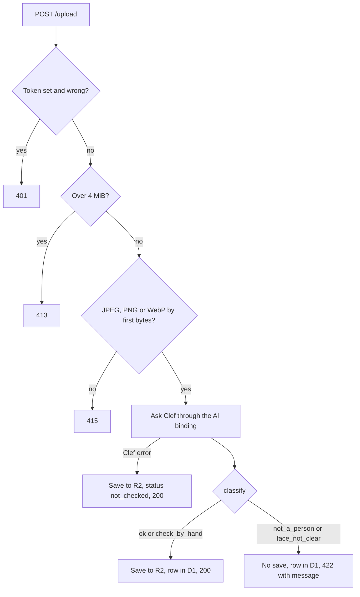

# photocheck

Smart validation for photo uploads, built on Cloudflare Workers AI.

Ordinary validation checks that a file is an image. photocheck checks that it is the right kind of image. The shipped preset is "profile photo": a real photo, of a person, with a clear face.

[](https://deploy.workers.cloudflare.com/?url=https://github.com/cutemonstre/photocheck)

## What it does

A membership organisation lets members upload a profile photo. Some uploads are fine. Many are not:

- a cartoon avatar or an anime drawing
- a pet meme with a caption
- a logo, or a screenshot of text
- a photo that is mostly a nose
- two people, so nobody knows which one is the member
- the back of someone's head

photocheck reads each photo and returns one of these statuses:

| Status | Meaning |
| --- | --- |
| `ok` | A real photo with a clear, whole face. |
| `check_by_hand` | Probably fine, but a person should look. |
| `face_not_clear` | A real photo, but no usable face. |
| `not_a_person` | Not a real photo of a person. |
| `unreadable` | The CLI could not open the file. |

There are two ways to use it:

- A **CLI** that scans a folder, a list of URLs or an R2 bucket and writes a CSV. Use it to clean up photos you already have.
- A **Worker** that sits in front of your upload form. It rejects bad photos with a plain message and stores good ones in R2. It also serves a small web app with two tabs: **Check** (drop photos, see the scores) and **Review** (approve or send back the photos a person should look at). It is built with TanStack Start and runs as the same Worker.

## Why a decision model

Each kind of check can see part of the problem:

- File type and size checks cannot see the content. A cartoon is a valid JPEG.
- A face detector says "there is a face". It cannot tell a photo from a cartoon, and it cannot say what else is in the frame.
- A general vision LLM can answer these questions too. But it returns prose that you have to parse, and it gives no calibrated number to set a threshold on.

Validation needs a number you can set a threshold on. [Clef](https://developers.cloudflare.com/workers-ai/models/clef/) is a decision model. You give it a state and typed questions. It returns a probability for every question. Yes/no questions return a probability between 0 and 1. Multiple-choice questions return the chosen option and a confidence. There is nothing to parse, and you can move a threshold up or down. It is also quick and cheap: in our use each photo took about a second and cost about $0.0003, because the model reads the image once and writes no text.

## How the Worker works



If Clef fails, the Worker fails open. The photo is saved and marked `not_checked`, so nobody is stuck. You can find those rows later with `GET /api/results?status=not_checked`.

## Quick start: CLI

You need Node 20 or newer.

```sh
git clone https://github.com/cutemonstre/photocheck && cd photocheck
npm install
cp .env.example .env     # then fill in your account ID and a Workers AI token
npx tsx src/cli/index.ts scan ./my-photos
```

`scan` takes a folder, a text file with one image URL per line, or `r2://bucket/prefix`. For each photo it prints one line, then a summary with counts per status, total input tokens, the estimated cost and the median time per photo. It also writes `photocheck-results.csv`.

```
ok             jane.jpg  real=0.99 face=0.98 whole=0.95 multi=0.02 subject=person(0.99)
not_a_person   cat.png   real=0.97 face=0.01 whole=0.00 multi=0.01 subject=animal(0.98)
```

Options:

| Option | Meaning |
| --- | --- |
| `--limit N` | Check only the first N photos. |
| `--questions-version N` | Use an older question set. |
| `--out FILE` | CSV path. Default `photocheck-results.csv`. |
| `--json` | Print JSON instead of text. |

Other commands:

- `photocheck questions` prints the current state, questions and thresholds.
- `photocheck eval <folder>` compares question versions on photos you have labelled. See the eval section below.

Before sending a photo, the CLI converts it to a JPEG with a longest side of 1024 px and applies EXIF rotation (`sharp`). On macOS it falls back to `sips` for HEIC and DNG files. If a file still cannot be read, it is marked `unreadable` and the run carries on.

If Clef fails (bad token, rate limit after retries, outage), the run stops with a clear message. Photos are never marked `unreadable` because of a Clef problem. Results so far are still written to the CSV.

To scan R2, add `R2_ACCESS_KEY_ID` and `R2_SECRET_ACCESS_KEY` to `.env`. Create them under R2, Manage API tokens.

To build the CLI for npm: `npm run build:cli`. The bin is `dist/cli/index.js`.

## Deploy the Worker

You need a Cloudflare account. Workers AI, R2 and D1 all have free tiers.

```sh
npm install

# 1. Build and deploy. Wrangler creates the R2 bucket and the D1 database on the first deploy.
npm run deploy

# 2. Create the tables
npx wrangler d1 migrations apply photocheck --remote

# 3. Recommended: require a bearer token on the data endpoints
npx wrangler secret put UPLOAD_TOKEN
```

Open the Worker URL. The app has two tabs, with no login:

- **Check**: drop one or many photos (JPEG, PNG or WebP). Each one gets a status, the message for the person, a bar for each probability, the main subject, and the round-trip time. A strip above the list shows counts per status, the median time, input tokens and the estimated cost. Nothing is stored in the browser. A "How it decides" panel lists the questions and rules, read from `src/core/questions.ts`.
- **Review**: lists stored photos with status `check_by_hand` or `not_checked`, with the photo, the scores and the buttons Approve, Needs new photo and Undo.

If `UPLOAD_TOKEN` is set, the app shows a token field after the first 401. The token is kept in memory only.

Call it from your own form:

```sh
curl -X POST https://photocheck.<your-subdomain>.workers.dev/upload \
  -H "Authorization: Bearer $UPLOAD_TOKEN" \
  -F photo=@me.jpg
```

A good photo returns 200 with `{ status, key, scores, message }`. A rejected photo returns 422 with a message you can show to the person uploading.

The page itself is public even when `UPLOAD_TOKEN` is set. The data endpoints (`/upload`, `/api/results`, `/photos/:key` and the review endpoint) all need the token.

### Endpoints

| Endpoint | What it does |
| --- | --- |
| `POST /upload` | Multipart field `photo`. Returns 200, 422, 413, 415, 400 or 401 with JSON. |
| `GET /api/results?status=` | Last 100 checks, newest first, including `review_status` and `reviewed_at`. |
| `GET /photos/:key` | Streams a stored photo from R2 with its content type. The key must be a UUID plus `.jpg`, `.png` or `.webp`, otherwise 404. |
| `POST /api/results/:id/review` | Body `{ "decision": "approved" \| "needs_new_photo" \| null }`. `null` clears the decision. |

The review columns come from a second migration, `migrations/0002_review.sql`. `wrangler d1 migrations apply` runs both. If you deployed an earlier version, apply it again.

Without `UPLOAD_TOKEN`, anyone who finds the URL can upload photos, which uses your Workers AI allowance and fills your R2 bucket. Set the token for anything beyond a quick demo, or call the Worker only from your own backend.

## The questions and the scoring rule

The state sent with every photo: "A profile photo a member uploaded. It should be a real photo of the member's own face."

| Key | Type | Asks | Since |
| --- | --- | --- | --- |
| `real_photo` | yes/no | Is it a real camera photograph, not a cartoon, drawing, logo or avatar? | v1 |
| `face_visible` | yes/no | Is a real human face clearly visible? | v1 |
| `subject` | choice | Main subject: person, animal, object or scene, cartoon or drawing, text or logo. | v1 |
| `whole_face` | yes/no | Is the whole face in the photo, from forehead to chin? | v2 |
| `multiple_people` | yes/no | Are two or more people shown prominently? | v2 |

Rules run in this order. The first match wins.

| # | Condition | Status |
| --- | --- | --- |
| 1 | `real < 0.3` | `not_a_person` |
| 2 | `subject` is not `person`, its confidence is at least 0.6 and `face < 0.3` | `not_a_person` |
| 3 | `real >= 0.7`, `face >= 0.7` and no framing issue | `ok` |
| 4 | `face < 0.2` | `face_not_clear` |
| 5 | anything else | `check_by_hand` |

A framing issue is `whole_face < 0.5` or `multiple_people >= 0.7`. Framing questions can only send a photo to a person. They never reject on their own. With version 1 they are not asked, so framing never triggers.

## Tune the questions, not the weights

There are no weights to train. Everything lives in one file, `src/core/questions.ts`.

1. Add a new question set to `QUESTION_SETS`, for example `3`. Do not edit an old version.
2. Set `CURRENT_VERSION` to the new number.
3. Change thresholds in `THRESHOLDS` if you need to.
4. Run `photocheck eval <folder>` on photos you have labelled. It runs every version and shows which photos changed status.
5. Keep the version if accuracy goes up.

The preset is for profile photos. For product photos, document scans or listings, rewrite the state and questions for your case. Keep the `classify` rules in step with the question keys it reads.

## Optional: eval

You do not need this to use photocheck. The scan command and the Worker work with nothing in `eval/`.

`photocheck eval <folder>` works on any folder that has images and a `labels.json`. Use your own photos if you have them:

```json
{
  "jane.jpg": { "expected": "ok" },
  "mascot.png": { "expected": "not_a_person", "note": "cartoon avatar" },
  "side.jpg": { "expected": ["ok", "check_by_hand"] }
}
```

`expected` can be one status or a list of acceptable statuses. The command prints accuracy per question version, a confusion table, the misses, and the photos that changed status between versions. Add `--versions 1,2` to pick versions and `--json` for machine output. If the folder has no images or no `labels.json`, it tells you what to add.

There is no sample set in this repo, on purpose. Results on someone else's photos do not tell you how the questions do on yours. Label 30 to 50 of your own photos, including the bad ones you want to catch, and measure on those.

## Cost

Clef costs $0.24 per million input tokens. Output is free. A photo resized to 1024 px costs about 700 to 1,500 input tokens, so 1,000 photos cost about 20 to 40 cents. The CLI prints its own estimate after every scan. Check [Workers AI pricing](https://developers.cloudflare.com/workers-ai/platform/pricing/) for the current rate.

## Gotchas

- Send `"model": "clef"`. `clef-flash` is rejected with error 3030.
- Clef does not accept image URLs. Send a `data:` URL or base64. PNG, JPEG and WebP only, up to 4 MiB.
- HEIC is not accepted. The CLI converts it. The Worker returns 415 and asks for a JPEG or PNG.
- The Worker checks the file type from its first bytes. The file name and the declared content type are ignored.
- The Worker stores the photo as uploaded. It does not resize.
- These are probabilities, not guarantees. Keep a person in the loop for `check_by_hand`.

## Development

```sh
npm test            # vitest, all offline, fetch is mocked
npm run typecheck   # tsc for the CLI and server code, then for the app
npm run dev         # Vite dev server on http://localhost:8788
npm run build       # builds the app and Worker into dist/
npm run preview     # serve the build locally
npm run build:cli   # builds the CLI into dist/cli
npx wrangler d1 migrations apply photocheck --local   # once, before the first run
```

The Workers AI binding always calls the real service, even in local dev, so uploads cost the usual fraction of a cent. Local R2 and D1 are simulated under `.wrangler/`.

Layout: `src/core` (shared questions, rules, Clef), `src/cli`, `src/server` (the upload gate, which has no framework imports and is what the tests cover), `src/routes` and `src/components` (the app).

Note: with no `.dev.vars` file, the dev server loads `.env` into the Worker, and a build copies it to `dist/server/.dev.vars`. If your `.env` holds CLI credentials, create a `.dev.vars` file (it can be empty, or hold `UPLOAD_TOKEN=...` for local use) so the Worker does not read them. Both files are gitignored and neither is uploaded on deploy.

## Built with

- [Cloudflare Workers](https://developers.cloudflare.com/workers/)
- [Workers AI](https://developers.cloudflare.com/workers-ai/) with [Clef](https://developers.cloudflare.com/workers-ai/models/clef/)
- [R2](https://developers.cloudflare.com/r2/)
- [D1](https://developers.cloudflare.com/d1/)
- [TanStack Start](https://tanstack.com/start) with React and Tailwind CSS

## Licence

MIT. See [LICENSE](LICENSE).
